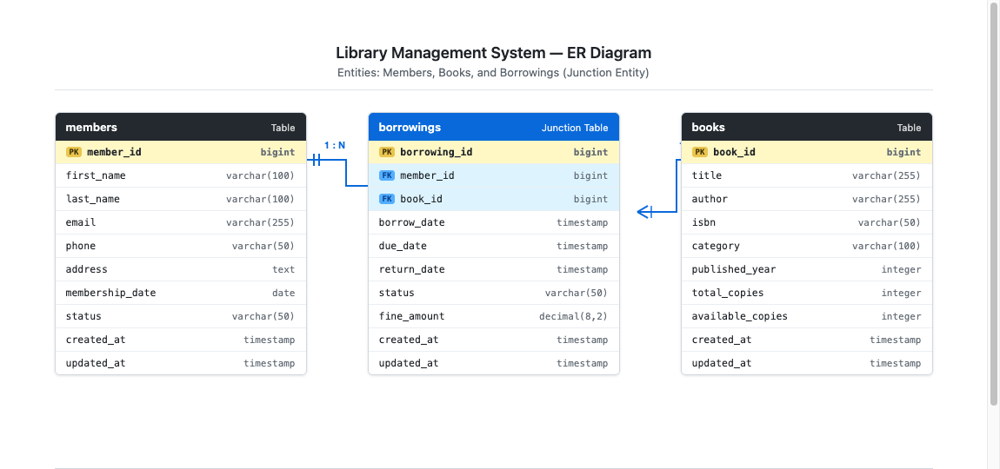

# S2-Homework 1: Library Management Setup

> **Course:** Web and Cloud Technologies (WCT) &mdash; Year 3, Semester 2  
> **Student:** Leang Khai  
> **Deliverable:** `Library_Management_Setup_Homework1.pdf`

---

## 1. Project Overview

This repository contains the setup for **Homework 1: Library Management Setup**, which covers:
1. Creating and running a new Laravel application (`library-management`).
2. An explanation of core Laravel architecture components (`app`, `routes`, `resources`, `database`, `.env`).
3. Creating and configuring a PostgreSQL database named `library_management`.
4. Designing an Entity-Relationship (ER) diagram for **Books**, **Members**, and **Borrowings**.

---

## 2. Laravel Directory Architecture Explanation

- **`app/`**: Contains the core application logic and domain models. Key subdirectories include `app/Models` (Eloquent ORM classes like `Book.php`, `Member.php`, `Borrowing.php`), `app/Http/Controllers` (handling incoming HTTP requests), and `app/Http/Middleware` (request filtering and authentication).
- **`routes/`**: Defines all application URL routes. `routes/web.php` maps browser requests with session support and CSRF protection, while `routes/api.php` handles stateless API endpoints.
- **`resources/`**: Houses uncompiled frontend presentation files, including Blade templates (`resources/views/`), raw stylesheets (CSS), and JavaScript assets.
- **`database/`**: Contains database migrations (`database/migrations/`), factories for generating test data, and database seeders (`database/seeders/`).
- **`.env`**: The environment configuration file that stores environment-specific values and credentials (database connection, application key, cache drivers) separate from source code.

---

## 3. Database Schema & ER Diagram

The system models library circulation using three relational entities:
- **`members`**: Stores patron identity and profile records.
- **`books`**: Stores catalog items, ISBN, and available copy inventory.
- **`borrowings`**: Junction entity that resolves the Many-to-Many relationship between members and books, recording `borrow_date`, `due_date`, `return_date`, `status`, and `fine_amount`.



### Cardinality Breakdown
- **Members &rarr; Borrowings:** `1 : 0..N` (One-to-Many)
- **Books &rarr; Borrowings:** `1 : 0..N` (One-to-Many)
- **Members &harr; Books:** `M : N` (Many-to-Many via Borrowings)

---

## 4. Setup and Installation Instructions

### Prerequisites
- PHP 8.2+
- Composer
- PostgreSQL 15+

### Installation Steps

1. **Clone the repository:**
   ```bash
   git clone https://github.com/leang-g/S2-HW1-WCT2.git
   cd S2-HW1-WCT2/library-management
   ```

2. **Install Composer dependencies:**
   ```bash
   composer install
   ```

3. **Configure Environment:**
   ```bash
   cp .env.example .env
   php artisan key:generate
   ```

   Update your `.env` with your PostgreSQL credentials:
   ```env
   DB_CONNECTION=pgsql
   DB_HOST=127.0.0.1
   DB_PORT=5432
   DB_DATABASE=library_management
   DB_USERNAME=your_username
   DB_PASSWORD=your_password
   ```

4. **Create the Database & Run Migrations:**
   ```bash
   # In PostgreSQL
   psql -U your_username -d postgres -c "CREATE DATABASE library_management;"

   # Run Laravel migrations and sample seeder
   php artisan migrate --seed
   ```

5. **Start Development Server:**
   ```bash
   php artisan serve
   ```
   Open `http://127.0.0.1:8000` in your web browser.
